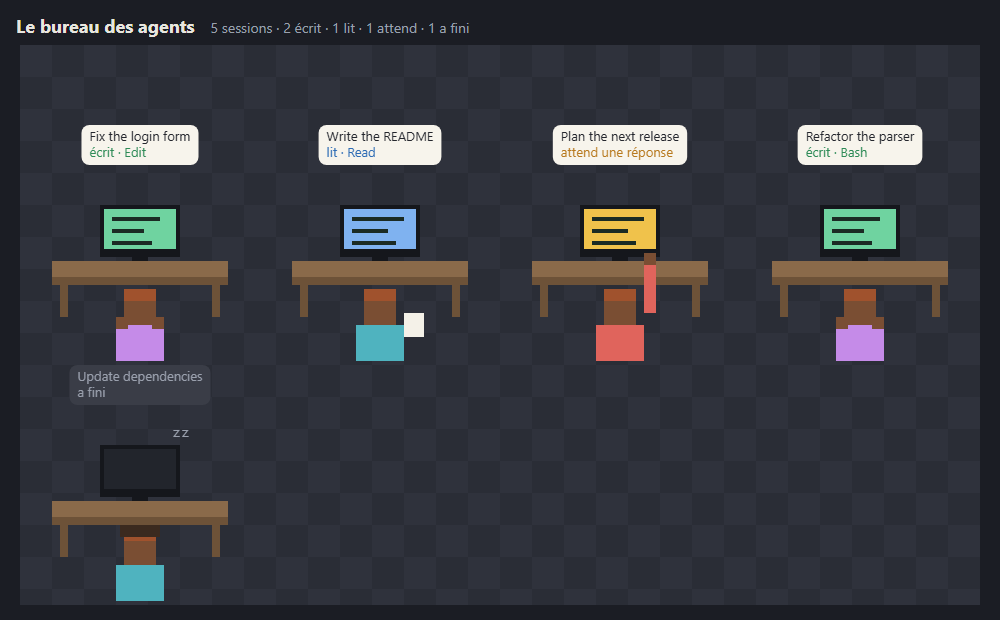

# Agents' office

A tiny local web page that shows each recent [Claude Code](https://docs.anthropic.com/en/docs/claude-code)
session as a pixel-art character at a desk. The character **types** when the session edits a file or
runs a command, **reads** when it searches, reads or thinks, **raises a hand** when it waits for you
(an answer or a permission), and **sleeps** when nothing has happened for 20 minutes. A speech bubble
shows the session title and the last tool used.



*Résumé en français : une page web locale où chaque session Claude Code récente est un personnage en
pixel art à son bureau — il écrit, lit, lève la main quand il vous attend, ou dort. Lecture seule,
`127.0.0.1` uniquement, sans dépendance. L'interface est en français.*

## Run

Requires Node.js 18 or later. No install, no dependencies.

```
node serveur.mjs
```

Then open http://127.0.0.1:4777 (`PORT=…` to change the port). `http://127.0.0.1:4777/?demo` shows
made-up sessions. Stop with Ctrl+C. The interface is in French.

## What it reads, what it never does

- It **reads only** the beginning and end of Claude Code's session logs
  (`~/.claude/projects/*/*.jsonl`) touched in the last 12 hours (`BUREAU_PROJETS=…` for another folder).
  It never writes to them. Sub-agent logs are ignored.
- It shows only a session's title, folder name and last tool name — never message contents, file
  contents or commands.
- The server listens on `127.0.0.1` only, checks the `Host` header (against DNS rebinding), accepts
  `GET` only and sends `Content-Security-Policy: default-src 'self'`. No network access, no
  telemetry, no dependencies.

## Limits

- States are guessed from the log: "waiting" also covers a tool call with no result for a minute,
  which is usually a permission prompt.
- The log format belongs to Claude Code and may change; the page then shows fewer details.

## Tests

```
node test.mjs
```

## License

MIT — see [LICENSE](LICENSE). Security issues: see [SECURITY.md](SECURITY.md).
